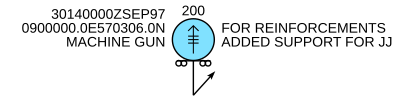
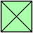
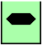
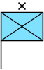
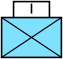
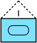
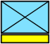
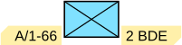
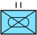
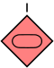

# milsymbol

[](https://github.com/luofang34/milsymbol/actions/workflows/ci.yml)
[](https://crates.io/crates/milsymbol)
[](https://docs.rs/milsymbol)
[](https://luofang34.github.io/milsymbol/)

Military unit symbols per **MIL-STD-2525** and **STANAG APP-6**, in native Rust.

The default renderer uses the pinned MIL-STD-2525E Change 1 and APP-6(E)
Version 2 standards. Code meanings follow the SIDC version; the renderer's
`Standard` selects display rules. `RenderMode::Milsymbol304` reproduces
[milsymbol.js 3.0.4](https://github.com/spatialillusions/milsymbol) by Måns
Beckman, with exact SVG and semantic checks against its oracle corpus.
Symbols are also exposed as typed drawing instructions for native renderers.

## Documentation

- **[Usage manual](https://luofang34.github.io/milsymbol/)**: installation,
  SIDCs, styling, text, output formats, map placement, drawing adapters,
  caching, extensions and WASM/embedded use, with an interactive symbol lab
  running this library as WASM.
- **[API reference](https://docs.rs/milsymbol)** on docs.rs: every type and
  method, the supported standards and feature flags.
- [UPSTREAM.md](UPSTREAM.md): compatibility baseline, generated-data
  provenance and known differences from milsymbol.js.
- [BENCHMARKS.md](BENCHMARKS.md): single-symbol, cached and bulk rendering
  performance and memory use.
- [CHANGELOG.md](CHANGELOG.md): release notes.

## Example



```rust
use milsymbol::Renderer;
use milsymbol::options::TextField;

let svg = Renderer::default()
    .symbol("130315003611010300000000000000")
    .size(35.0)
    .direction(750.0 * 360.0 / 6400.0)
    .text(TextField::Quantity, "200")
    .text(TextField::StaffComments, "FOR REINFORCEMENTS")
    .text(TextField::AdditionalInformation, "ADDED SUPPORT FOR JJ")
    .text(TextField::Type, "MACHINE GUN")
    .text(TextField::Dtg, "30140000ZSEP97")
    .text(TextField::Location, "0900000.0E570306.0N")
    .render()?
    .to_svg();
# Ok::<(), milsymbol::RenderError>(())
```

This is figure 13 of MIL-STD-2525C, rendered by this crate.

## Installation

```toml
[dependencies]
milsymbol = "0.5"
```

Requires Rust 1.88 or later. Before 1.0, the minimum supported Rust
version may be raised in a patch release; such a change is announced in the
CHANGELOG, and CI builds the library on it. Optional features (`serde`,
`compact-paths`, and `std`, which is on by default) are listed in the
[API reference](https://docs.rs/milsymbol#feature-flags).

## Quick start

```rust
use milsymbol::Renderer;

let renderer = Renderer::default();
let symbol = renderer.symbol("130310001412110000000000000000").size(35.0).render()?;
let svg: String = symbol.to_svg();
let data_url: String = symbol.to_data_url(); // data:image/svg+xml;utf8,…

let anchor = symbol.anchor();   // pixel offset of the map position (frame centre or HQ staff foot)
let size = symbol.size();       // width and height in pixels
let info = symbol.metadata();   // typed: affiliation, dimension, status, echelon, mobility, …
let ok = symbol.sidc_validity().is_valid(); // false for unknown codes, which still render with a "?" icon
# Ok::<(), milsymbol::RenderError>(())
```


The manual's [first render](https://luofang34.github.io/milsymbol/manual/getting-started.html)
and [worked examples](https://luofang34.github.io/milsymbol/manual/examples.html)
continue from here.

## Features

- MIL-STD-2525B/C/D/E and STANAG APP-6 B/D/E, legacy letter SIDCs and
  numeric SIDCs; APP-6(E) Version 2 on request.
- Filled/unfilled, framed/unframed, monochrome, outlined symbols; text
  amplifiers; movement indicators and speed leaders; engagement bars;
  headquarters, task force, feint/dummy, installation, echelon and mobility
  indicators; operational condition; exercise/simulation markers.
- SVG output, plus a typed drawing IR (`Path`, `Circle`, `Text`,
  `Translate`, `Rotate`, `Scale`) with path segments for GPU, canvas and
  other renderers.
- Strict SIDC parsing and validation, typed metadata, and SIDC editing
  without string surgery.
- No JavaScript at build or run time. `no_std + alloc` core; builds for
  `wasm32` and bare-metal targets. The only dependency is `libm`.
- No global state: a `Renderer` holds configuration and extensions
  (custom icons, drawing stages, colour modes), is `Send + Sync`, and renders
  deterministically.

## Gallery

### Standard identities and dimensions

| | Friend | Hostile | Neutral | Unknown |
|---|:-:|:-:|:-:|:-:|
| Air |  |  |  |  |
| Land |  |  |  |  |
| Sea surface |  |  |  |  |
| Subsurface |  |  |  |  |

The fourth digit of a numeric SIDC is the standard identity (`3` friend,
`6` hostile, `4` neutral, `1` unknown); digits 5–6 are the symbol set (`01`
air, `10` land unit, `30` sea surface, `35` subsurface). See
[SIDCs and validation](https://luofang34.github.io/milsymbol/manual/sidcs.html).

### Amplifiers and modifiers

| | | |
|:-:|:-:|:-:|
| <br>`10031002181211000000`<br>headquarters, brigade | <br>`10031004151211000000`<br>task force, company | <br>`10031001151205000000`<br>feint/dummy armour company |
| <br>`10031500331101000000`<br>tracked equipment | <br>`10031010001211000000`<br>planned | <br>`10031030001211000000`<br>damaged |
| <br>`10151000001211000000`<br>exercise joker | <br>`10032000001101000000`<br>installation | <br>`direction: 60, speedLeader: 60`<br>speed leader |
| <br>`engagementBar: "2:10"`<br>engagement bar | | |

See [frames, modifiers, and movement](https://luofang34.github.io/milsymbol/manual/modifiers.html).

### Styles

| | | |
|:-:|:-:|:-:|
| <br>`fill: false` | <br>`colorMode: "Dark"` | <br>`monoColor: "rgb(20,60,160)"` |
| <br>`outlineWidth: 5` | <br>`frame: false` | <br>`infoBackground` |

Options are typed values with builder setters; milsymbol.js option names
also work through `SymbolOptions::set`:

```rust
use milsymbol::{Renderer, options::{Color, TextField}};

let symbol = Renderer::default()
    .symbol("10031000001211000000")
    .size(40.0)
    .outline_width(5.0)
    .outline_color(Color::WHITE)
    .mono_color(Color::rgb(20, 60, 160))
    .text(TextField::UniqueDesignation, "A/1-66")
    .render()?;
# Ok::<(), milsymbol::RenderError>(())
```

See [colours and styling](https://luofang34.github.io/milsymbol/manual/styling.html)
and [text and fonts](https://luofang34.github.io/milsymbol/manual/text.html).

### APP-6

| `16031000161211020000`<br>mechanized infantry battalion | `16061000151205000000`<br>hostile armour company | `16030100001103000000`<br>unmanned aircraft |
|:-:|:-:|:-:|
|  |  |  |

These are APP-6(E) Version 2 SIDCs (version `16`). `Standard::App6` and
`Standard::App6EVersion2` select its display rules; the SIDC version selects
the code table independently.

```rust
use milsymbol::{Renderer, Standard};
let app6 = Renderer::builder().standard(Standard::App6EVersion2).build();
let svg = app6.symbol("16031000161211020000").render()?.to_svg();
# Ok::<(), milsymbol::RenderError>(())
```

### Letter SIDCs

| MIL-STD-2525C `SFGPUCFRM---` | 2525C sea mine `SHUPWMGX----` |
|:-:|:-:|
|  |  |

| SIDC form | Standards |
|---|---|
| Numeric (20 or 30 digits) | MIL-STD-2525D/E, 2525E Change 1 (`15`); APP-6D/E, APP-6(E) Version 2 (`16`) |
| Letter (10–15 characters) | MIL-STD-2525B (incl. change 2), 2525C; APP-6B |

`Standard::App6` draws letter SIDCs as APP-6B. Single-point graphics are
supported; geographic lines and areas requiring multiple control points are
excluded explicitly.

## Compatibility

The baseline is milsymbol.js 3.0.4 (commit `b05f2d7`). In
`RenderMode::Milsymbol304` the SVG output is byte-identical to upstream on
the checked-in differential corpus. Option names are the same as
milsymbol.js, and its global calls (`ms.addSymbolPart`, `ms.addIcons`,
`ms.setColorMode`, …) map to `Renderer::builder()` methods. The manual's
[compatibility chapter](https://luofang34.github.io/milsymbol/manual/compatibility.html)
has the full mapping; [UPSTREAM.md](UPSTREAM.md) lists every deliberate
difference.

## Development

```sh
cargo test                           # unit, API, property and oracle-corpus tests (no Node)
tools/ci/check.sh                    # the CI native job; tools/ci/check-linux.sh runs it on Linux
tools/ci/lint.sh stable 1.88:lib     # clippy with warnings denied on each toolchain
tools/ci/lint-config.sh              # every crate carries the workspace lint table
tools/check-book.sh                  # build the manual and test its examples
cargo run --example readme_images    # regenerates docs/images (or pass an output dir)
tools/oracle/diff.sh options         # live diff against milsymbol.js (needs Node)
tools/oracle/check-all.sh            # every suite, in parallel (x64 Node also checks fixtures)
tools/codegen/regenerate.sh          # regenerate src/generated from upstream (needs Node)
```

The manual's [maintenance chapter](https://luofang34.github.io/milsymbol/manual/maintenance.html)
describes the book tooling; [UPSTREAM.md](UPSTREAM.md) describes the oracle
and regeneration tooling.

## License

Copyright © 2026 Fang Luo and contributors. Licensed under the
**GNU Affero General Public License v3.0 or later** ([LICENSE](LICENSE)).

This crate is a derivative of milsymbol.js © Måns Beckman
(spatialillusions.com), used under the MIT License; the upstream notice is
retained in [LICENSE-MIT-milsymbol](LICENSE-MIT-milsymbol) and applies to the
upstream-derived portions. See [NOTICE](NOTICE).
