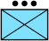

# Introduction

`milsymbol` draws military symbols in native Rust. Give it a Symbol Identification
Code (SIDC), choose presentation options, and receive an immutable `Symbol` with
SVG output, drawing primitives, metadata, bounds, and placement anchors.

The library ports [milsymbol.js](https://github.com/spatialillusions/milsymbol)
3.0.4. Its built-in geometry is native data; composition, layout, and serialization
run in Rust. Applications need no JavaScript engine, Node installation, browser,
runtime network access, or generated image catalogue.

This manual describes the source checkout. The published crate may lag APIs on
`main`; use the documentation shipped with your chosen release, or use a pinned
Git revision when adopting unreleased functionality.

## Where things are documented

| Document | Contents |
|---|---|
| This manual | Application workflows, how the APIs fit together, practical limits |
| [API reference](https://docs.rs/milsymbol) (docs.rs) | Every type and method, supported standards, feature flags |
| [README](https://github.com/luofang34/milsymbol#readme) | Overview, installation and a gallery of rendered symbols |
| [UPSTREAM.md](https://github.com/luofang34/milsymbol/blob/main/UPSTREAM.md) | Compatibility baseline, generated-data provenance, known differences |
| [BENCHMARKS.md](https://github.com/luofang34/milsymbol/blob/main/BENCHMARKS.md) | Rendering performance and memory measurements |
| [CHANGELOG.md](https://github.com/luofang34/milsymbol/blob/main/CHANGELOG.md) | Release notes |

## The rendering flow

1. Keep a `Renderer` configured for your application's standard and extensions.
2. Supply a SIDC as text or as a parsed `sidc::Sidc`.
3. Set `SymbolOptions` through the symbol builder or a reusable options value.
4. Render once, then use the symbol's output and placement information together.

`Renderer::default()` selects MIL-STD-2525 behaviour. APP-6 is explicit renderer
configuration. A symbol's options can override that choice. Identical SIDCs,
options, and renderer configuration produce deterministic output.

For applications that need images, start with [SVG output](manual/output.md). For maps,
also read [placement](manual/placement.md): the image dimensions and anchor depend on
the actual symbol, labels, staff, and movement indicators. For a GPU or canvas
adapter, use the [drawing view](manual/drawing.md).

## Choose the right layer

| Task | Entry point |
|---|---|
| Render a symbol | `Renderer::symbol(...).render()` |
| Reject malformed or unsupported symbols | Add `.strict()` |
| Check syntax without rendering | `Sidc::parse` or `Sidc::parse_for` |
| Check support with your extensions | `Renderer::check_sidc` |
| Export an image | `Symbol::to_svg`, `Symbol::to_data_url` |
| Draw through another graphics backend | `Symbol::drawing` |
| Add a custom icon or drawing stage | `IconExtension`, `SymbolPart` |
| Reuse composed symbols | `cache::CachedRenderer` |
| Compare with the JavaScript oracle | `compat` |

The library supplies symbols, not a map projection, tactical database, font
shaper, or map renderer. Store your operational data separately and derive its
SIDC and labels when preparing a display. See [compatibility](manual/compatibility.md)
before treating a successfully drawn symbol as standards validation.

## Licensing

The Rust crate is licensed under AGPL-3.0-or-later. Upstream tables and other
included material retain their licences and attribution in the repository's
`LICENSE`, `NOTICE`, and upstream licence files. Consult those files when choosing
how to distribute an application or derivative work.
