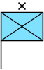
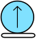
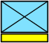

# Frames, modifiers, and movement

The SIDC determines affiliation, dimension, status, icon, echelon, mobility, and
HQ/task-force/feint indicators. Presentation options determine how those parts
are drawn. Keep that distinction when building an editor: a stroke colour change
does not change the symbol's affiliation metadata.

## Common numeric examples

| SIDC | Meaning |
|---|---|
| `10031000001211000000` | Friendly infantry |
| `10031000161211000000` | Infantry battalion |
| `10031002181211000000` | Infantry headquarters, brigade |
| `10031004151211000000` | Infantry task force, company |
| `10031001151205000000` | Feint/dummy armour company |
| `10031500331101000000` | Tracked land equipment |
| `10031010001211000000` | Planned infantry |
| `10031030001211000000` | Damaged infantry |
| `10151000001211000000` | Exercise Joker infantry |

| Headquarters brigade | Tracked equipment | Damaged infantry |
|---|---|---|
|  |  |  |

The eighth numeric digit combines feint/dummy (`1`), headquarters (`2`), and task
force (`4`) flags. For example, `6` combines HQ and task force. A headquarters
staff changes the placement anchor; see [placement](placement.md).

The two amplifier digits describe echelon or mobility according to the symbol
kind. Modifier sectors select additional icons, and extended SIDCs may select
a different modifier set. Use the applicable standard's tables instead of
assuming that a modifier has the same meaning in every symbol set.

## Direction and speed leaders

`direction` is in degrees clockwise from north: `0` is up and `90` is right.
Without a speed leader, the library draws a movement arrow. A nonzero
`speed_leader` selects a line of the requested length instead. The option is a
drawing length, not a velocity conversion: calculate length from your own speed,
time horizon, and map scale. Reference scaling changes its pixel footprint.

```rust
# extern crate milsymbol;
use milsymbol::Renderer;

let renderer = Renderer::default();
let arrow = renderer.symbol("10031000001211000000")
    .direction(60.0)
    .render()?;
let leader = renderer.symbol("10031000001211000000")
    .direction(60.0)
    .speed_leader(60.0)
    .render()?;
assert_ne!(arrow.to_svg(), leader.to_svg());
# Ok::<(), milsymbol::RenderError>(())
```

Angles need not be restricted to one revolution, but must be finite. If exact
upstream floating-point output matters, select the matching
`ReferencePlatform`; [configuration](configuration.md) explains it.

## Additional indicators

`stack` draws repeated frames behind a symbol. `TextField::EngagementBar` and
`EngagementType` control the upstream engagement indicator. Text fields such as
`ReinforcedReduced`, `SpecialHeadquarters`, and `HeadquartersElement` add their
standard placements rather than arbitrary application-positioned labels.

```rust
# extern crate milsymbol;
use milsymbol::{Renderer, options::TextField};

let symbol = Renderer::default()
    .symbol("10031000001211000000")
    .stack(2.0)
    .text(TextField::EngagementBar, "2:10")
    .text(TextField::EngagementType, "TARGET")
    .text(TextField::ReinforcedReduced, "+")
    .render()?;
assert!(symbol.size().height > 0.0);
# Ok::<(), milsymbol::RenderError>(())
```

Use reasonable application limits for stack counts and text lengths. These
options consume space and memory in proportion to the requested output.
