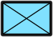

# Colours and styling

Use builder setters for common choices and `.with(...)` for complete access to
`SymbolOptions`. Calls apply in order. Calling `.options(value)` replaces the
options accumulated so far; subsequent setters edit that replacement.

```rust
# extern crate milsymbol;
use milsymbol::{Renderer, options::{Color, TextField}};

let symbol = Renderer::default()
    .symbol("10031000001211000000")
    .size(40.0)
    .fill(false)
    .outline_width(3.0)
    .outline_color(Color::WHITE)
    .text(TextField::UniqueDesignation, "A/1-66")
    .with(|options| {
        options.style.padding = 8.0;
        options.style.info_size = 30.0;
        options.style.stroke_width = 3.0;
    })
    .render()?;
assert!(!symbol.options().style.fill);
# Ok::<(), milsymbol::RenderError>(())
```

| Outlined | Unfilled | Monochrome |
|---|---|---|
|  |  |  |

## Colour modes and overrides

The built-in `Light`, `Medium`, and `Dark` modes provide per-affiliation fills.
Select one with `.color_mode(ColorModeChoice::named("Dark"))`. A renderer can
register additional named `color::ColorMode` values. An unknown mode name is a
typed rendering error.

`Color::BLACK`, `Color::WHITE`, and `Color::rgb(r, g, b)` cover common values.
`Color::new(text)` rejects an empty string but does not parse all CSS colour
syntax. SVG serialization escapes attributes; a separate
[drawing adapter](drawing.md) must support the colour syntax it consumes.

`ColorChoice` accepts either a uniform `Color` or a `ColorMode` with colours per
affiliation. Use it for frame, icon, information-field, and outline overrides.
`mono_color` applies one colour to the symbol; it is the simplest choice for a
single-colour overlay. `fill_color` is a separate uniform fill override.

## Style reference

All fields below belong to `options.style`. Start from `Style::default()` rather
than a struct literal; public configuration structs are non-exhaustive.

| Fields | Effect |
|---|---|
| `size`, `padding`, `square` | Scale, extra bounds, square layout around the anchor |
| `fill`, `frame`, `icon` | Visibility of the corresponding symbol parts |
| `color_mode`, `civilian_color` | Named/custom palette; civilian colouring |
| `fill_color`, `fill_opacity` | Frame fill override and opacity |
| `frame_color`, `icon_color` | Uniform or per-affiliation overrides |
| `mono_color` | One-colour rendering when set |
| `stroke_width` | Nominal frame stroke width |
| `outline_color`, `outline_width` | Outline around the symbol; width `0` disables it |
| `info_fields`, `info_size`, `info_color` | Information-field visibility, font size, colour |
| `info_background`, `info_background_frame` | Information-field background and its border |
| `info_outline_color`, `info_outline_width` | Information text outline; `None` follows the symbol outline |
| `font_family`, `icon_text_uses_font_family` | Text font selection; see [fonts](text.md) |
| `hq_staff_length` | Override the renderer's headquarters staff length |
| `simple_status_modifier` | Prefer the simple slash status indicators |
| `alternate_medal` | Select alternate MEDAL sea-mine icons |
| `style_fill` | Replace designated style-fillable regions with translucent white |
| `standard` | Override the renderer's standard for this symbol |

The default reference size is `100`, stroke width `4`, fill opacity `1`,
information size `40`, font family `Arial`, and outline width `0`.
Fill, frame, icon, information fields, and civilian colouring default to enabled.

Do not treat every dimension as an independent pixel margin. Most geometry is
expressed in reference symbol units and then scaled. Read the rendered
`size()`, `bounding_box()`, and `anchor()` to lay it out.

Finite values are required. The library preserves upstream behaviour for many
unusual finite values; an application that needs a constrained editor should
also enforce its own sensible size, opacity, padding, and label limits.
